# AWS-S3-Configuration

Created an AWS S3 bucket, configured its settings, and uploaded a shoes e-commerce website. Learned how to manage files and store website content using Amazon S3.

## 📌 Project Overview

This project demonstrates how to create and configure an Amazon S3 bucket using the AWS Management Console.

Amazon S3 (Simple Storage Service) is an object storage service used to store, manage, and retrieve data from anywhere.

The project covers bucket creation, security configuration, file uploads, versioning, encryption, and access management.

## 🎯 Project Objectives

- Create an Amazon S3 bucket.
- Configure bucket settings.
- Enable bucket versioning.
- Configure server-side encryption.
- Upload and manage files.
- Configure public access restrictions.
- Understand S3 bucket permissions and security.

## 🛠️ AWS Services Used

| Service | Purpose |
|---|---|
| Amazon S3 | Cloud object storage |
| AWS Management Console | Resource management |

## ⚙️ Project Implementation

### 🪜 Step 1: Open Amazon S3 Service

1. Log in to the AWS Management Console.
2. Enter `S3` in the AWS search bar.
3. Select **S3 – Scalable Storage in the Cloud** from the Services results.

**Description:**

Navigated to Amazon S3 through the AWS Management Console. Amazon S3 is a scalable cloud object storage service used to store, manage, and retrieve data securely.

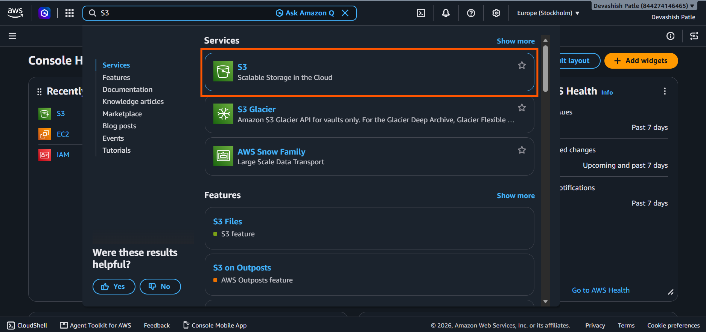

---

### 🪜 Step 2: Open the Amazon S3 Dashboard

1. After selecting Amazon S3 from the AWS Management Console, the S3 dashboard opens.
2. Review the S3 overview and storage information.
3. Click on **Create bucket** to start configuring a new S3 bucket.

**Description:**

Opened the Amazon S3 dashboard and explored its object storage functionality. Selected the **Create bucket** option to begin setting up a storage bucket for storing and managing files in AWS.

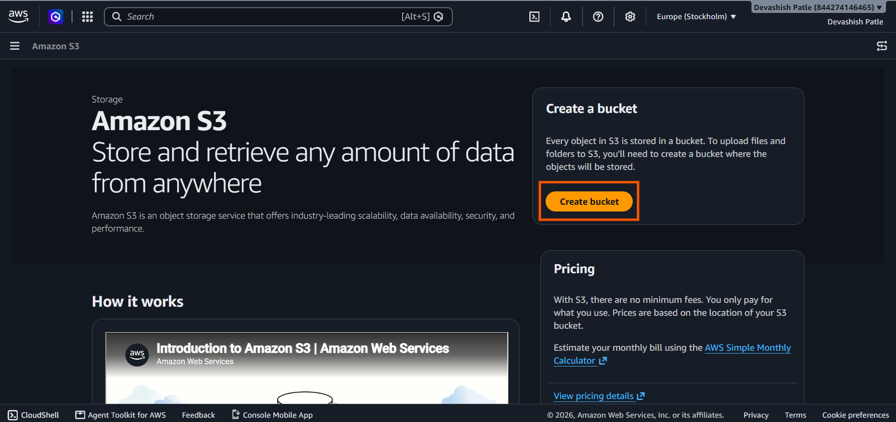

---

### 🪜 Step 3: Configure S3 Bucket Settings

1. Select the AWS Region: **Europe (Stockholm) – eu-north-1**.
2. Choose **General purpose** as the bucket type.
3. Keep **Global namespace** selected.
4. Enter the bucket name: `aws-s3-bucket-demo-devashish`.

**Description:**

Configured a new Amazon S3 general-purpose bucket in the Europe (Stockholm) region. Selected the global namespace and provided a unique bucket name to identify the storage resource.

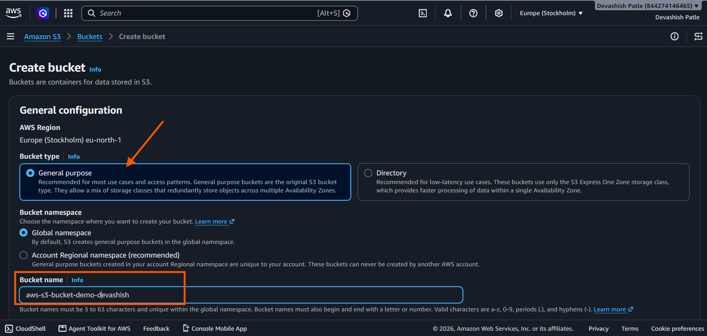

---

### 🪜 Step 4: Configure Block Public Access Settings

1. Navigate to the **Block Public Access settings** section.
2. Review the four public access restriction options.
3. Uncheck **Block all public access** to allow the bucket's public access configuration to be customized.
4. Select the acknowledgment checkbox to confirm that the bucket and its objects may become publicly accessible.

**Description:**

Configured the Amazon S3 bucket's public access settings. Reviewed the access restrictions and acknowledged the security implications of allowing public access.

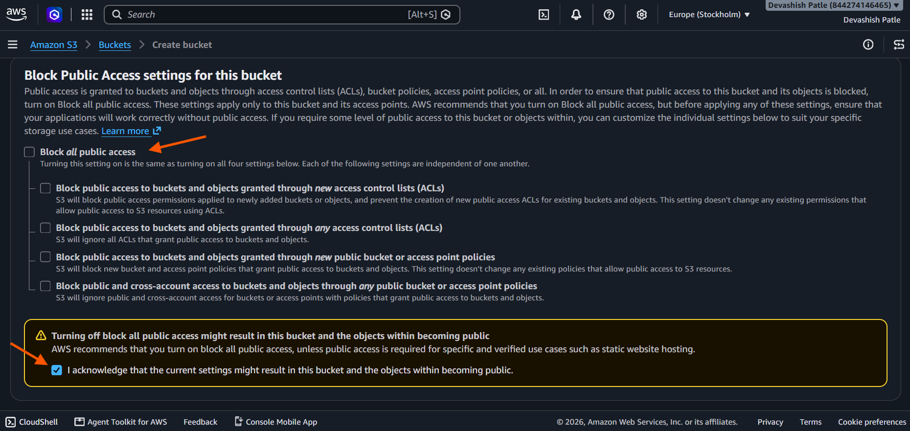

---

### 🪜 Step 5: Configure Bucket Versioning and Tags

1. Navigate to the **Bucket Versioning** section.
2. Select **Enable** to activate versioning for the S3 bucket.
3. Review the optional **Tags** section.
4. No tags are added in this configuration.

**Description:**

Enabled Amazon S3 Bucket Versioning to maintain multiple versions of objects within the same bucket. Versioning helps recover previous versions of files in case of accidental deletion or unwanted modifications. Reviewed the optional tagging feature for resource organization and management.

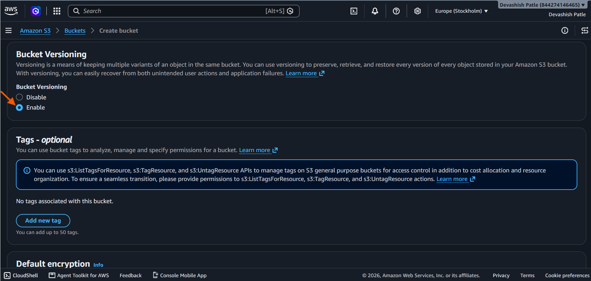

---

### 🪜 Step 6: Configure Default Encryption

1. Navigate to the **Default encryption** section.
2. Select **Server-side encryption with Amazon S3 managed keys (SSE-S3)**.
3. Enable the **Bucket Key** option.
4. Review the Advanced settings.
5. Click **Create bucket** to create the S3 bucket.

**Description:**

Configured default server-side encryption using SSE-S3 to automatically encrypt newly uploaded objects with Amazon S3-managed encryption keys. Enabled the S3 Bucket Key option to help reduce AWS KMS request costs when using SSE-KMS. Finally, initiated bucket creation.

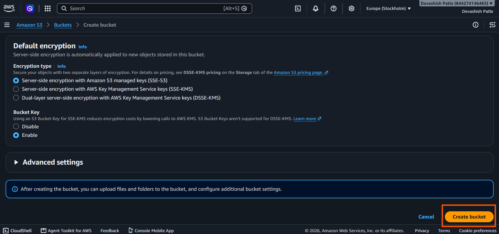

---

### 🪜 Step 7: Successfully Create the S3 Bucket

1. After configuring the bucket settings, click **Create bucket**.
2. AWS successfully creates the bucket named `aws-s3-bucket-demo-devashish`.
3. Open the newly created bucket.
4. Navigate to the **Objects** tab.
5. Click **Upload** to begin adding files and folders to the bucket.

**Description:**

Successfully created an Amazon S3 bucket named `aws-s3-bucket-demo-devashish`. Verified the bucket creation confirmation in the AWS Management Console and accessed the Objects section. The bucket is ready to store files and folders.

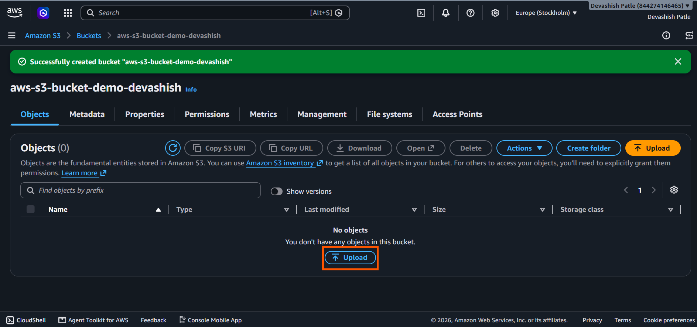

---

### 🪜 Step 8: Select Files and Folders for Upload

1. Open the S3 bucket `aws-s3-bucket-demo-devashish`.
2. Click the **Upload** button.
3. On the Upload page, select **Add files** to upload individual files.
4. Alternatively, select **Add folder** to upload an entire folder.
5. Review the selected files and folders before uploading.
6. Verify the destination bucket shown on the page.

**Description:**

Opened the Amazon S3 upload interface to prepare files and folders for cloud storage. Explored the Add files and Add folder options to upload data directly into the configured S3 bucket.

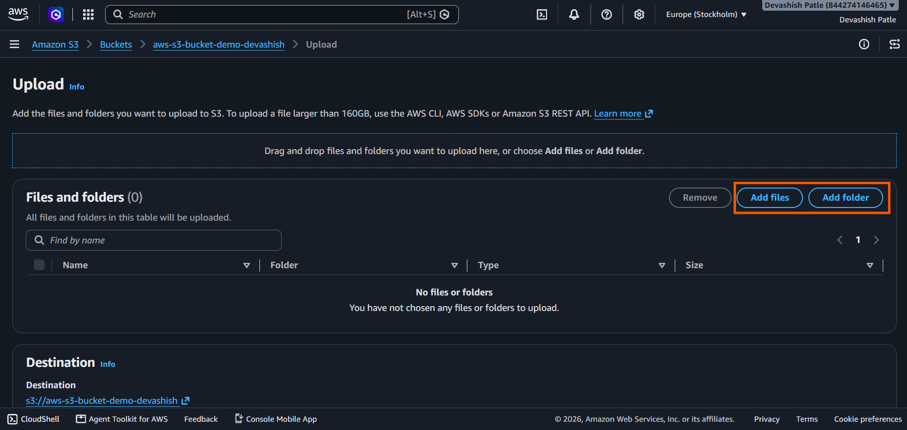

---

### 🪜 Step 9: Upload HTML File to Amazon S3

1. Open the `aws-s3-bucket-demo-devashish` bucket.
2. Open the `Buy-Shoes` folder.
3. Click **Upload**.
4. Select **Add files** and choose `index.html` from your computer.
5. Verify that the file appears in the Files and folders section.
6. Check the destination path:
   `s3://aws-s3-bucket-demo-devashish/Buy-Shoes/`
7. Click the **Upload** button to upload the HTML file.

**Description:**

Selected the `index.html` file and configured it for upload to the `Buy-Shoes` folder in Amazon S3. Verified the destination path and prepared the file for cloud storage.

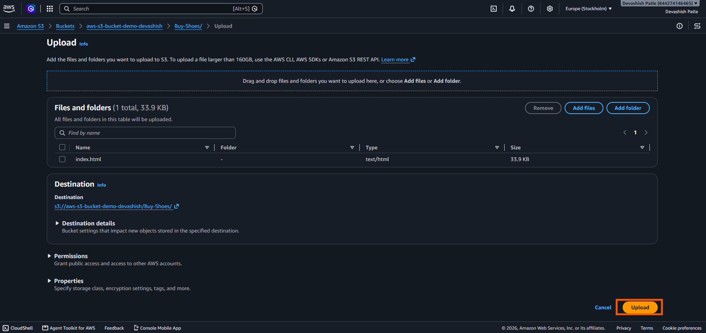

---

### 🪜 Step 10: Verify Successful File Upload

1. After clicking the **Upload** button, AWS displays the Upload Status page.
2. Verify the destination path:
   `s3://aws-s3-bucket-demo-devashish/Buy-Shoes/`
3. Check the upload summary:
   - **Total files:** 1
   - **Successfully uploaded:** 1 file
   - **File size:** 33.9 KB
   - **Failed uploads:** 0
4. Verify that `index.html` shows the status **Succeeded**.

**Description:**

Successfully uploaded the `index.html` file to the Amazon S3 bucket inside the `Buy-Shoes` folder. Verified the upload status, confirming that 1 file (33.9 KB) was uploaded successfully with zero failures.

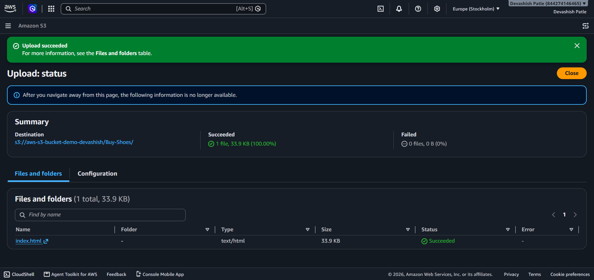

---

### 🪜 Step 11: View Uploaded File Properties

1. Open the Amazon S3 bucket `aws-s3-bucket-demo-devashish`.
2. Navigate to the `Buy-Shoes` folder.
3. Click the uploaded `index.html` file.
4. Open the **Properties** tab.
5. Review the object details:
   - **File name:** index.html
   - **File type:** HTML
   - **File size:** 33.9 KB
   - **Storage location:** Europe (Stockholm) – eu-north-1
   - **Object key:** Buy-Shoes/index.html
6. Review the S3 URI and Object URL.
7. Click **Open** to attempt to access the uploaded object.

**Description:**

Verified the uploaded HTML file in Amazon S3 by reviewing its object properties, storage location, file size, S3 URI, ARN, and Object URL. This step helps understand how S3 stores and identifies individual objects.

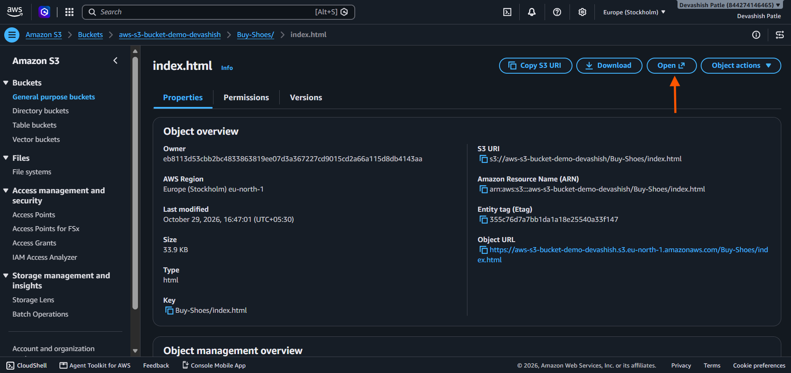

---

### 🪜 Step 12: Verify the Shoes Website

1. Open the uploaded `index.html` file from the Amazon S3 bucket.
2. Access the configured website endpoint or object URL, depending on your S3 setup.
3. Verify that the website loads correctly in the browser.
4. Check the homepage layout and visual elements:
   - SOLESTUDIO website logo
   - Navigation menu
   - Featured shoes banner
   - Explore the Collection button
   - Shopping bag icon
5. Confirm that the website content is displayed properly.

**Description:**

Verified the uploaded shoes e-commerce website by opening it in a browser. The SOLESTUDIO homepage was displayed with its navigation menu, featured shoe banner, and shopping interface, demonstrating the website's frontend presentation.

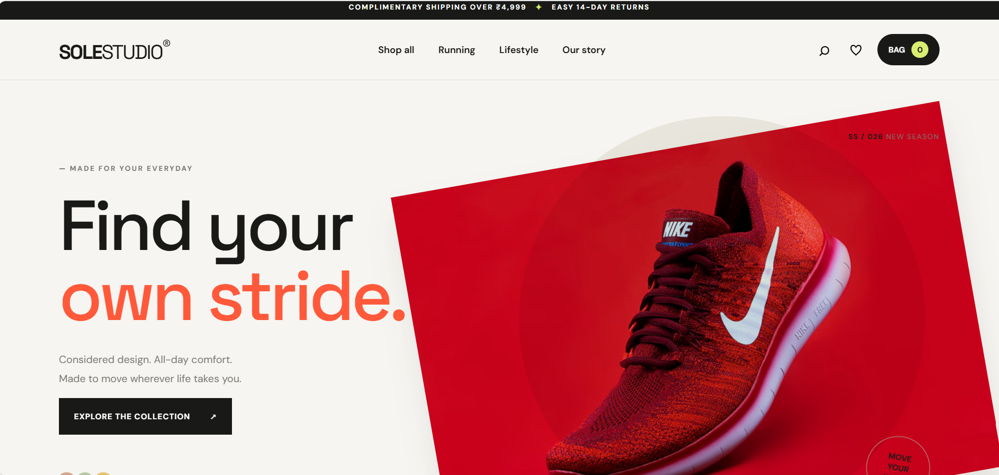

